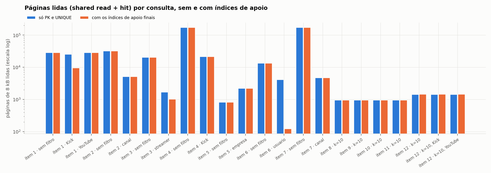
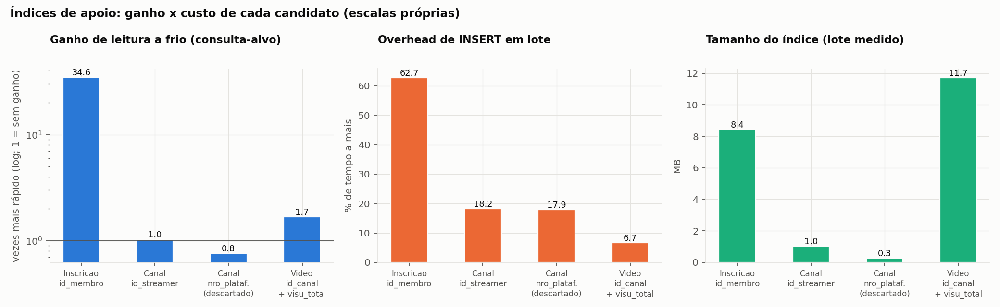
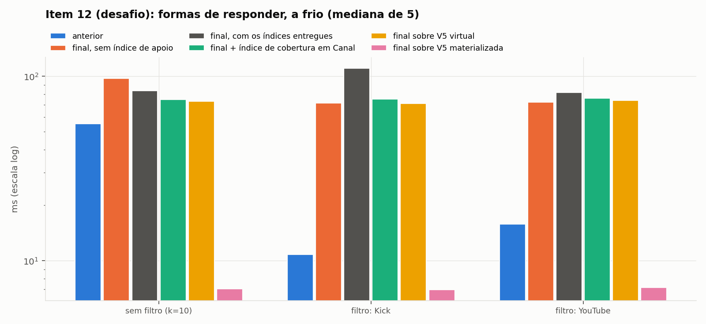

# Stream do Bedo · Benchmark

Este arquivo reúne as comparações de desempenho que embasaram as decisões de
consultas, views e índices (seções 9 a 11 do [decisions.md](decisions.md)). Os
gráficos estão em [`imagens/`](imagens/).

Cada teste abaixo traz:
- **O que foi medido:** a pergunta que o teste responde;
- **Como:** o que muda entre as barras e o que fica fixo;
- **Legenda do gráfico:** o que são os eixos, as cores e os rótulos;
- **Resultado:** os números e a conclusão.

## Ambiente e protocolo

| Item | Valor |
|---|---|
| Banco | PostgreSQL 17.11 (Docker `postgres:17`, aarch64), num MacBook Air M1 |
| Configuração | Padrão do container: `shared_buffers` 128 MB, `work_mem` 4 MB, `effective_cache_size` 4 GB |
| Sessão de medida | `jit = off` e `max_parallel_workers_per_gather = 0`, para os tempos serem comparáveis |
| Dados | Seed na escala 1: cerca de 8,7 milhões de registros e 1,5 GB de schema |
| Medida | `EXPLAIN (ANALYZE, BUFFERS)` da chamada real da function |
| A frio | Antes de **cada** medida: reinício do Postgres (esvazia o `shared_buffers`) e `drop_caches` na VM do Docker (esvazia o cache do sistema). Vale só se houver `shared read` > 0 |
| A quente | Uma execução de aquecimento e depois as medidas, sem reiniciar |
| Repetições | 5 por cenário; o valor usado é a **mediana** |
| Volume | 810 medidas de consulta e 14 de escrita |

### Como ler os números

- **Páginas lidas** (`shared read + hit`) são a métrica mais estável. O tempo a
  frio de consultas de poucos milissegundos varia dezenas de ms entre repetições,
  por causa do primeiro acesso ao disco e ao catálogo.
- **Os tempos absolutos dependem da máquina.** O que vale é a comparação entre
  cenários.
- **As medições foram feitas com a chave de `Video` em UUID v7,** gerado por uma
  function própria (tag `v1.1.0`). A versão atual usa o UUID v4 nativo
  (`gen_random_uuid()`). Na comparação em lote, os dois tiveram o mesmo tamanho
  de tabela e de índice; o v4 inseriu cerca de 9% mais devagar. Os planos e as
  páginas lidas das consultas não dependem da versão do UUID.
- **Escala log:** nos gráficos de tempo e de páginas, o eixo vertical é
  logarítmico (cada linha de grade vale 10 vezes a anterior), porque os valores
  vão de poucos milissegundos a dezenas de segundos. Uma barra com metade da
  altura de outra **não** vale metade.

### Rótulos usados no eixo horizontal

Os gráficos 01, 02 e 06 têm uma barra por consulta, no formato
`item N · filtro`. O número é o da consulta do enunciado; o filtro é o valor
passado ao parâmetro opcional:

| Rótulo | Valor passado | Por que esse valor |
|---|---|---|
| `sem filtro` | parâmetro nulo (`DEFAULT NULL`) | Consulta sobre o banco inteiro |
| `Kick` | plataforma Kick | Plataforma pequena: o filtro devolve poucos canais (é o caso em que índice ajuda) |
| `YouTube` | plataforma YouTube | Plataforma grande: 28% dos canais (o filtro devolve muito, e índice não ajuda) |
| `canal` | `Echo.Queen 136733 TV` | O canal com mais visualizações, ou seja, com mais vídeos e comentários |
| `streamer` | `echo.queen_136733` | O dono desse canal |
| `usuario` | `ghost.yt_297686` | O membro com mais inscrições |
| `empresa` | `Red Bull GmbH` | A empresa que mais patrocina |
| `k=10` | `p_k = 10` | Top-10 nos itens 8 a 11 |

## 1. Frio × quente: por que medir a frio

**O que foi medido:** quanto o cache esconde do custo real de cada consulta. O
professor alertou que, repetindo a consulta, o dado vem da memória e o índice
parece não fazer diferença.

**Como:** as mesmas consultas, sem índices de apoio (só PK, `UNIQUE` e os
`UNIQUE` das views materializadas), medidas de dois jeitos. Muda só o estado do
cache.

**Legenda do gráfico 06:**
- **Eixo vertical:** tempo de execução em ms, escala log.
- **Eixo horizontal:** uma consulta por grupo (rótulos na tabela acima).
- **Azul, "a frio":** reinício do Postgres e `drop_caches` antes de cada medida;
  as páginas vêm do disco.
- **Laranja, "a quente":** a mesma consulta repetida sem reiniciar; as páginas já
  estão na memória.

**Resultado:**

| Consulta | A frio | A quente | Diferença |
|---|---:|---:|---:|
| Item 2, filtro por canal | 326 ms | 5 ms | 65× |
| Item 3, filtro por streamer | 175 ms | 9 ms | 19× |
| Item 7, filtro por canal | 228 ms | 5 ms | 48× |
| Item 1, plataforma pequena (Kick) | 587 ms | 257 ms | 2,3× |
| Item 1, sem filtro | 1.498 ms | 1.108 ms | 1,4× |

- **Nas consultas com filtro seletivo, a diferença é enorme:** elas leem poucas
  páginas, e a quente essas páginas já estão na memória.
- **Nas consultas sem filtro, a diferença é pequena:** elas leem a tabela quase
  inteira, que não cabe no `shared_buffers` de 128 MB, então até a quente boa
  parte vem do disco ou do cache do sistema.
- **No item 6 sem filtro a quente ficou acima do frio:** é variação entre
  repetições, não efeito do cache.

Medindo só a quente, quase toda consulta filtrada parece instantânea, e o índice
"não faz diferença". Por isso as comparações seguintes são a frio.

## 2. Reescrita das consultas antes dos índices

**O que foi medido:** se mudar a forma da consulta resolve a lentidão antes de
criar índice, como o professor orientou.

**Como:** os itens 2 e 3, com e sem filtro, escritos de três formas, todas sem
índices de apoio e a frio. Muda só o texto da consulta.

**Legenda do gráfico 03:**
- **Eixo vertical:** tempo de execução em ms, escala log.
- **Eixo horizontal:** item e filtro (`canal` e `streamer` como na tabela de
  rótulos).
- **Azul, "original":** a primeira versão, que conta os comentários de **todos**
  os vídeos e só depois filtra o canal ou o streamer.
- **Laranja, "reescrita":** filtra o canal ou o streamer primeiro e conta só os
  comentários desses vídeos, numa passada.
- **Verde, "final":** lê a contagem pronta da view materializada V3.

**Resultado:**

| Consulta | Original (agrega tudo, depois filtra) | Reescrita (filtra antes) | Final (sobre a V3) |
|---|---:|---:|---:|
| Item 2, sem filtro | 7.951 ms | 14.642 ms | 10.247 ms |
| Item 2, filtro por canal | 3.730 ms | 828 ms | **326 ms** (11×) |
| Item 3, sem filtro | 5.964 ms | 29.955 ms | **853 ms** (7×) |
| Item 3, filtro por streamer | 6.799 ms | 979 ms | **175 ms** (39×) |

- **Filtrar antes de agregar** resolve os casos com filtro.
- **Sem filtro, a reescrita direta piora:** agrupar 5 milhões de comentários
  estoura o `work_mem` e ordena em disco. Esses casos foram resolvidos pela view
  materializada V3.
- **O item 2 sem filtro continua caro.** Ele devolve e ordena 1,25 milhão de
  vídeos, e o custo é ordenar a saída. Com `LIMIT`, que é como a consulta é
  usada, vira uma ordenação parcial em memória.

## 3. Consulta direta × view virtual × view materializada

**O que foi medido:** se as views aceleram os rankings top-k, e qual tipo de
view faz a diferença.

**Como:** os itens 10 e 11 com `k = 10`, a frio, sem índices de apoio. Muda só
de onde a consulta lê.

**Legenda do gráfico 04:**
- **Eixo vertical:** tempo de execução em ms, escala log.
- **Eixo horizontal:** item 10 (top-10 canais por doações) e item 11 (top-10
  canais por faturamento total).
- **Azul, "consulta direta":** junta e soma as tabelas base (`Doacao`,
  `Inscricao`, `Patrocinio` etc.) a cada chamada.
- **Laranja, "views virtuais V1/V2":** a mesma soma, escrita sobre as views
  virtuais; o planejador expande a view dentro da consulta.
- **Verde, "materializada V4":** lê o faturamento por canal já somado e só
  ordena.

**Resultado:**

| Consulta (k = 10) | Direta nas tabelas | Sobre as views virtuais V1/V2 | Sobre a materializada V4 |
|---|---:|---:|---:|
| Item 10 | 2.409 ms | 1.569 ms | **26 ms** (93×) |
| Item 11 | 4.022 ms | 3.312 ms | **52 ms** (77×) |

- **A view virtual não acelera:** o planejador a expande dentro da consulta. A
  pequena diferença vem de a V1 já juntar o canal antes de agrupar, não da view
  em si.
- **A materializada muda a ordem de grandeza,** em troca de dados com atraso.

**Custo de atualizar as materializadas** (tempo do `REFRESH`, mediana de 3, sem
gráfico):

| View | `REFRESH` comum | `REFRESH CONCURRENTLY` |
|---|---:|---:|
| V3 `mv_interacoes_video` (1,25 milhão de linhas) | 7,9 s | 19,1 s |
| V4 `mv_faturamento_canal` (22,6 mil linhas) | 1,1 s | 1,3 s |

O `CONCURRENTLY` não bloqueia leituras, mas é mais lento. Por isso a
atualização é periódica, e não por trigger.

## 4. Sem × com índices de apoio

**O que foi medido:** o efeito dos 5 índices de apoio escolhidos, consulta por
consulta.

**Como:** as consultas dos itens 1 a 11, a frio, já na forma final (com as views
V3 e V4). Muda só a presença dos índices de apoio das tabelas base.

**Legenda dos gráficos 01 e 02:**
- **Eixo vertical do 01:** tempo de execução a frio em ms (mediana de 5), escala
  log.
- **Eixo vertical do 02:** páginas de 8 KB lidas pela consulta (`shared read +
  hit`), escala log. Mostra o trabalho de leitura sem o ruído do tempo.
- **Eixo horizontal:** uma consulta por grupo (rótulos na seção "Ambiente").
- **Azul, "só PK e UNIQUE":** sem índices de apoio nas tabelas base. Os `UNIQUE`
  das views materializadas já existem, porque o `REFRESH CONCURRENTLY` os exige.
- **Laranja, "com os índices de apoio finais":** com `idx_inscricao_id_membro`,
  `idx_canal_id_streamer` e `idx_video_id_canal_cobertura`.

**Resultado.** Onde há um índice que atende o predicado, a mudança aparece no
plano e nas páginas lidas:

| Consulta | Sem índice de apoio | Com índice de apoio | Índice |
|---|---|---|---|
| Item 6, filtro por usuário | 160 ms, 4.040 páginas (`Seq Scan inscricao`) | **7 ms**, 54 páginas | `idx_inscricao_id_membro` |
| Item 1, plataforma pequena (Kick) | 587 ms, 25.526 páginas (`Seq Scan video`) | **341 ms**, 9.530 páginas (*Index Only Scan*) | `idx_video_id_canal_cobertura` |
| Item 3, filtro por streamer | 1.554 páginas; 9 ms a quente | **892 páginas**; 1,3 ms a quente | `idx_canal_id_streamer` |

Onde **não** há ganho, o plano e as páginas lidas são os mesmos com e sem
índice (barras iguais no gráfico 02):
- **Itens sem filtro (1, 4, 6, 7) e item 1 com o YouTube** (28% dos canais):
  leem quase a tabela toda, e a varredura sequencial vence. É o caso "todos
  americanos" do professor.
- **Itens 8 a 11:** ordenam as 22,6 mil linhas da V4 em milissegundos.

Algumas barras do gráfico 01 sobem com os índices, sem nenhuma mudança de plano
nem de páginas lidas no gráfico 02:
- item 1 sem filtro, de 1,5 para 2,2 s;
- item 2 sem filtro, de 10 para 15 s;
- item 5 por empresa, de 13 para 62 ms.

Esses três casos não usam nenhum índice novo. A diferença é variação da leitura
a frio no disco da VM; a ordenação externa do item 2 é a mais sensível a isso.

## 5. Hash × B-tree nos predicados de igualdade

**O que foi medido:** qual tipo de índice serve melhor quando o predicado é só
de igualdade (`coluna = valor`), como o professor sugeriu avaliar.

**Como:** as duas consultas cujo filtro é só igualdade, a frio e a quente. Muda
só o tipo do índice na mesma coluna: item 3 por streamer (`Canal.id_streamer`) e
item 6 por usuário (`Inscricao.id_membro`).

**Legenda do gráfico 07:**
- **Eixo vertical:** tempo de execução em ms, escala log.
- **Eixo horizontal:** consulta e estado do cache, entre parênteses.
- **Azul:** índice B-tree.
- **Laranja:** índice hash.

**Resultado** (o tamanho e o `INSERT` são do teste de escrita da seção 6):

| Índice | Tipo | Páginas lidas | Tamanho (lote de teste) | `INSERT` em lote |
|---|---|---:|---:|---:|
| `Inscricao (id_membro)` | B-tree | 54 | 8,7 MB | 2.118 ms |
| `Inscricao (id_membro)` | hash | 54 | 10,6 MB | 2.310 ms |
| `Canal (id_streamer)` | B-tree | 892 | 1,1 MB | 342 ms |
| `Canal (id_streamer)` | hash | 892 | 1,3 MB | 344 ms |

- **Os dois leem as mesmas páginas.** As diferenças de tempo no gráfico vão nos
  dois sentidos: no item 6 o hash foi mais lento a frio (37 contra 7 ms) e mais
  rápido a quente (0,6 contra 1,4 ms). São consultas de poucos milissegundos, em
  que a variação entre repetições é desse tamanho.
- **O hash ficou maior e não inseriu mais rápido.** Ficou o B-tree, que também
  entrega os dados em ordem e é o que a verificação de FK usa.

## 6. Ganho × custo de escrita

**O que foi medido:** se o ganho de leitura de cada índice compensa o custo que
ele cria em toda inserção. É o "considerar o overhead de inserção" do item
mandatório 4.

**Como:**
- **Ganho:** tempo a frio da consulta que o índice atende, sem e com ele
  (seção 4).
- **Custo:** `INSERT ... SELECT` de linhas da própria tabela, em ordem aleatória
  (`ORDER BY random()`, como chegariam os dados reais), numa cópia vazia com as
  mesmas PK, `UNIQUE` e `CHECK`, com e sem o índice. `CHECKPOINT` antes de cada
  rodada; 3 rodadas; mediana. A cópia não tem FKs, para medir só o custo de
  manter o índice.
- **Lote:** 300 mil linhas em `Inscricao` e `Video`; a tabela inteira em `Canal`
  (35,9 mil).

**Legenda do gráfico 05** (três painéis, cada um com a sua escala; cada barra é
um índice, identificado pela tabela e pela coluna):
- **Painel azul, "Ganho de leitura a frio":** quantas vezes a consulta-alvo ficou
  mais rápida com o índice, em escala log. A linha horizontal em 1 significa "sem
  ganho". Consultas-alvo: item 6 por usuário (`Inscricao`), item 3 por streamer
  (`Canal`) e item 1 com o Kick (`Video`).
- **Painel laranja, "Overhead de INSERT em lote":** quanto a mais de tempo o
  `INSERT` do lote levou com o índice, em %.
- **Painel verde, "Tamanho do índice":** tamanho do índice **no lote medido**, em
  MB. Não é o tamanho na tabela inteira, que está na última coluna da tabela
  abaixo.

**Resultado:**

| Índice | Linhas | Sem índice | Com índice | Overhead | Ganho de leitura | Tamanho na tabela inteira |
|---|---:|---:|---:|---:|---:|---:|
| `idx_inscricao_id_membro` | 300 mil | 1.328 ms | 2.118 ms | +59% | 22× | 10 MB |
| `idx_canal_id_streamer` | 35,9 mil | 292 ms | 342 ms | +17% | 1,2× (páginas 1.554 → 892) | 0,7 MB |
| `idx_video_id_canal_cobertura` | 300 mil | 4.196 ms | 4.590 ms | +9% | 1,7× | 38 MB |

- **O mais caro, de `Inscricao`, é aceito:** inscrição é escrita rara e a busca
  por usuário é frequente.
- **`Canal (nro_plataforma)` foi descartado.** Era um índice de uma versão
  anterior. Na nova medição não teve ganho: `Canal` tem 951 páginas e é lida em
  milissegundos.

## 7. Item 12 (desafio)

**O que foi medido:** quanto custa a versão final do item 12 (que dá a posição
da plataforma no ranking geral mesmo com filtro) e se uma view ou um índice a
mais compensariam.

**Como:** três chamadas do item 12, todas com `k = 10`: sem filtro, com filtro
pela Kick (plataforma pequena) e pelo YouTube (plataforma grande). A frio,
mediana de 5. Muda só a forma de implementação.

**Legenda do gráfico 08:**
- **Eixo vertical:** tempo de execução a frio em ms, escala log.
- **Eixo horizontal:** sem filtro, filtro Kick e filtro YouTube.
- **Azul, "anterior (DEC-029)":** a primeira versão, que com filtro só olhava a
  plataforma pedida e respondia "1º de 1".
- **Laranja, "final, sem índice de apoio":** a versão entregue, sem os índices
  de apoio.
- **Verde, "final + índice de cobertura em Canal":** a versão entregue com um
  6º índice candidato, `Canal (nro_plataforma, id_streamer) INCLUDE
  (qtd_visualizacoes)`.
- **Amarelo, "final sobre V5 virtual":** a contagem por plataforma escrita como
  view virtual.
- **Rosa, "final sobre V5 materializada":** a contagem por plataforma gravada
  numa view materializada de 28 linhas.
- **Barras ausentes:** as variantes com V5 não foram medidas com o filtro
  YouTube.
- **Fora do gráfico:** a versão final com os índices de apoio entregues está na
  tabela abaixo.

**Resultado** (tempo a frio / a quente, com as páginas lidas entre parênteses):

| Forma | Sem filtro (k = 10) | Filtro Kick | Filtro YouTube |
|---|---|---|---|
| Versão anterior (sem posição global) | 57 / 91 ms (675) | 56 / 5 ms (672) | 31 / 13 ms (672) |
| Final, sem índices de apoio | 139 / 67 ms (1.438) | 99 / 47 ms (1.435) | 67 / 62 ms (1.435) |
| **Final, com os índices finais** | 64 / 67 ms (1.450) | 67 / 43 ms (1.447) | 62 / 42 ms (1.447) |
| Final + índice de cobertura em `Canal` | 66 / 49 ms (1.468) | 65 / 73 ms (1.465) | 67 / 44 ms (1.465) |
| Sobre uma V5 virtual | 73 / 46 ms (1.382) | 63 / 41 ms (1.378) | — |
| Sobre uma V5 materializada | 10 / 1,2 ms (302) | 8 / 1,3 ms (303) | — |

- **O custo vem da posição global.** Para dar a posição real mesmo com filtro, a
  consulta lê `Canal` inteira (cerca de 670 páginas) e conta os streamers
  distintos. Por isso a versão anterior era mais barata com filtro, mas
  respondia errado ("1º de 1").
- **Índice de cobertura em `Canal`: descartado.** O planejador não o usa, e ele
  seria o 6º índice.
- **V5 materializada: medida e não adotada.** O ganho é de cerca de 50 ms numa
  resposta de 28 linhas, e o item 12 deixaria de ser exato até a próxima
  atualização da view.

## Arquivos de origem

As medidas brutas (`resultados.csv`, `escrita.csv`), os planos em JSON, os
scripts de medição (`medir.sh`, `aferir.py`, `graficos.py`) e o inventário de
predicados estão na pasta `bench/` da tag `v1.1.0`.
