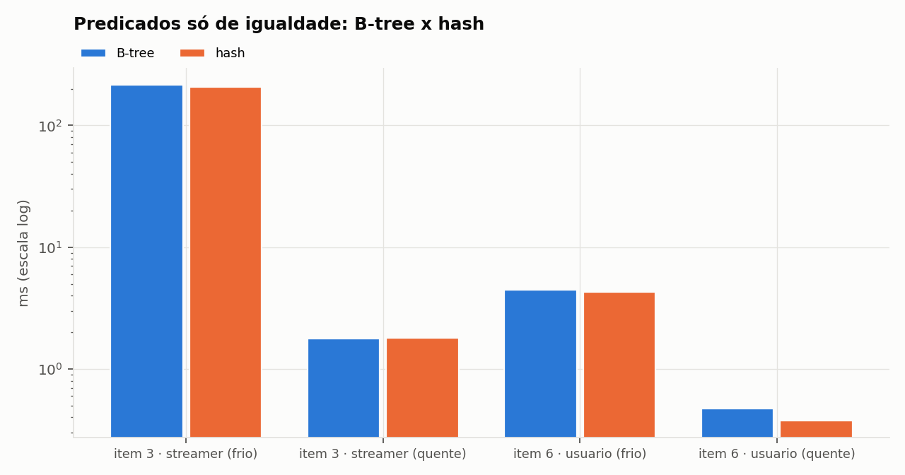

# Stream do Bedo · Benchmark

Este arquivo reúne as comparações de desempenho que embasaram as decisões de
consultas, views e índices (seções 9 a 11 do
[decisoes_detalhamento.md](decisoes_detalhamento.md), resumidas no
[decisoes_resumo.md](decisoes_resumo.md)). Os gráficos estão em
[`imagens/`](imagens/).

Cada teste abaixo traz:
- **O que foi medido:** a pergunta que o teste responde;
- **Como:** o que muda entre as barras e o que fica fixo;
- **Legenda do gráfico:** o que são os eixos, as cores e os rótulos;
- **Resultado:** os números e a conclusão. **Cada número é um link** para o
  arquivo com o `EXPLAIN ANALYZE` de onde ele saiu (ver "De onde vem cada
  número", logo abaixo). Esses arquivos, os scripts e os dados brutos ficam na
  pasta `bench/` da tag [`v2.1.0`](https://github.com/LuizMVB/steam_do_bedo/tree/v2.1.0/bench), fora da versão atual do
  repositório, e os links apontam para lá.

## Ambiente e protocolo

| Item | Valor |
|---|---|
| Banco | PostgreSQL 17.12 (Docker `postgres:17`, aarch64), num MacBook Air M1 ([configuracao.txt](https://github.com/LuizMVB/steam_do_bedo/blob/v2.1.0/bench/configuracao.txt)) |
| Configuração | Padrão do container: `shared_buffers` 128 MB, `work_mem` 4 MB, `effective_cache_size` 4 GB |
| Sessão de medida | `jit = off` e `max_parallel_workers_per_gather = 0`, para os tempos serem comparáveis |
| Dados | Seed na escala 1, versão atual (chave de `Video` em UUID v4 nativo): cerca de 8,7 milhões de registros e 1,5 GB de schema |
| Medida | `EXPLAIN (ANALYZE, BUFFERS)` da chamada real da function |
| A frio | Antes de **cada** medida: parada do Postgres (esvazia o `shared_buffers`), `drop_caches` na VM do Docker (esvazia o cache do sistema) e nova subida |
| A quente | Uma execução de aquecimento descartada e depois as medidas, sem reiniciar |
| Repetições | 5 por cenário; o valor usado é a **mediana** |
| Volume | 760 medidas de consulta (76 cenários × 2 estados de cache × 5), 27 de `INSERT` e 12 de `REFRESH` |
| Script | [`bench/aferir.py`](https://github.com/LuizMVB/steam_do_bedo/blob/v2.1.0/bench/aferir.py), com as consultas alternativas em [`bench/consultas_alternativas.sql`](https://github.com/LuizMVB/steam_do_bedo/blob/v2.1.0/bench/consultas_alternativas.sql) |

### De onde vem cada número

Cada célula medida (consulta × cenário de índices × cache) tem um arquivo em
[`bench/planos/`](https://github.com/LuizMVB/steam_do_bedo/tree/v2.1.0/bench/planos/). O arquivo começa com um cabeçalho e traz
depois o plano completo:

```text
-- Item 6 · filtro: usuario · variante: final
-- Cenário de índices: final (índices de apoio entregues: ...)
-- Cache: frio (restart do Postgres + drop_caches antes de cada repetição)
-- Consulta medida:
--   EXPLAIN (ANALYZE, BUFFERS) SELECT * FROM steam_do_bedo.sp_obter_qtd_canais_e_gasto_mensal_por_usuario('ghost.yt_297686');
-- Repetições (Execution Time e Buffers do nó raiz de cada uma):
--   rep | execução (ms) | planejamento (ms) | shared read | shared hit | páginas
--     1 |         9.159 |            28.129 |          54 |         69 |     123
--     2 |         2.627 |            13.541 |          54 |         69 |     123
--     3 |         7.057 |            17.468 |          54 |         69 |     123
--     4 |         4.478 |            17.778 |          54 |         69 |     123  <- mediana
--     5 |         4.257 |            12.670 |          54 |         69 |     123
-- Mediana do tempo: 4.478 ms (repetições em ordem: 2.6, 4.3, 4.5, 7.1, 9.2)
-- Abaixo, o plano completo da repetição 4 (a mediana).

Subquery Scan on "*SELECT*"  (cost=30.00..30.01 rows=1 width=136) (actual time=3.896..3.900 rows=1 loops=1)
  Buffers: shared hit=69 read=54          <- páginas lidas = 54 + 69 = 123
  ...
Execution Time: 4.478 ms                  <- o tempo citado (4,5 ms)
```

- **Tempo citado** = `Execution Time` da repetição mediana. O arquivo guarda o
  plano **dessa** repetição, então o número do texto aparece no fim do plano.
- **Páginas lidas** = `shared read + shared hit` da linha `Buffers` do nó raiz
  (a primeira do plano), na mesma repetição.
- **Nó que explica o resultado** (`Seq Scan`, `Index Only Scan` etc.) é o que
  aparece no plano do arquivo.
- **Todas as repetições**, com tempo e páginas, estão em
  [`bench/resultados.csv`](https://github.com/LuizMVB/steam_do_bedo/blob/v2.1.0/bench/resultados.csv). A coluna `mediana = 1`
  marca a repetição do plano gravado, e a coluna `plano` dá o caminho do
  arquivo.
- **Item 12 é plpgsql:** o `EXPLAIN` de fora mostra só um `Function Scan`. Por
  isso as chamadas plpgsql rodaram com `auto_explain`
  (`log_nested_statements`), e o plano da consulta de dentro está no mesmo
  arquivo, logo depois do plano externo.

Os nomes dos arquivos seguem `<consulta>__<variante>__<cenário>__<cache>.txt`,
agrupados por fase: `base/` (sem índices de apoio), `final/` (com os índices
entregues), `reescrita/`, `hash/`, `plataforma/`, `item12/` e `escrita/`.

### Como ler os números

- **Páginas lidas** são a métrica mais estável. Elas se repetem quase
  idênticas nas 5 repetições, enquanto o tempo a frio de uma mesma consulta
  chega a variar de 2 a 3 vezes (o arquivo de cada plano mostra as 5
  repetições lado a lado). A causa é o disco da VM do Docker: o
  `drop_caches` esvazia o cache dentro da VM, mas o macOS ainda pode ter
  parte do arquivo de disco da VM em memória.
- **Os tempos absolutos dependem da máquina.** O que vale é a comparação entre
  cenários.
- **Escala log:** nos gráficos de tempo e de páginas, o eixo vertical é
  logarítmico (cada linha de grade vale 10 vezes a anterior), porque os valores
  vão de poucos milissegundos a dezenas de segundos. Uma barra com metade da
  altura de outra **não** vale metade.

### Rótulos usados no eixo horizontal

Os gráficos 01, 02 e 06 têm uma barra por consulta, no formato
`item N · filtro`. O número é o da consulta do enunciado; o filtro é o valor
passado ao parâmetro opcional ([filtros.json](https://github.com/LuizMVB/steam_do_bedo/blob/v2.1.0/bench/filtros.json)):

| Rótulo | Valor passado | Por que esse valor |
|---|---|---|
| `sem filtro` | parâmetro nulo (`DEFAULT NULL`) | Consulta sobre o banco inteiro |
| `Kick` | plataforma Kick | Plataforma pequena (3,5% dos canais): o filtro devolve poucos canais (é o caso em que índice ajuda) |
| `YouTube` | plataforma YouTube | Plataforma grande: 28% dos canais (o filtro devolve muito, e índice não ajuda) |
| `canal` | `Echo.Queen 136733 TV` | O canal com mais visualizações, ou seja, com mais vídeos e comentários |
| `streamer` | `echo.queen_136733` | O dono desse canal |
| `usuario` | `ghost.yt_297686` | O membro com mais inscrições |
| `empresa` | `Red Bull GmbH` | A empresa que mais patrocina |
| `k=10` | `p_k = 10` | Top-10 nos itens 8 a 12 |

## 1. Frio × quente: por que medir a frio


**O que foi medido:** quanto o cache esconde do custo real de cada consulta. O
professor alertou que, repetindo a consulta, o dado vem da memória e o índice
parece não fazer diferença.

**Como:** as mesmas consultas, sem índices de apoio (só PK, `UNIQUE` e os
`UNIQUE` das views materializadas), medidas de dois jeitos. Muda só o estado do
cache. Planos em [`bench/planos/base/`](https://github.com/LuizMVB/steam_do_bedo/tree/v2.1.0/bench/planos/base/).

**Legenda do gráfico 06:**
- **Eixo vertical:** tempo de execução em ms, escala log.
- **Eixo horizontal:** uma consulta por grupo (rótulos na tabela acima).
- **Azul, "a frio":** reinício do Postgres e `drop_caches` antes de cada medida;
  as páginas vêm do disco.
- **Laranja, "a quente":** a mesma consulta repetida sem reiniciar; as páginas já
  estão na memória.

**Resultado** (páginas lidas do disco, `shared read`, entre parênteses):

| Consulta | A frio | A quente | Diferença |
|---|---:|---:|---:|
| Item 2, filtro por canal | [631 ms](https://github.com/LuizMVB/steam_do_bedo/blob/v2.1.0/bench/planos/base/i02_com__final__sem_apoio__frio.txt) (2.955) | [11,3 ms](https://github.com/LuizMVB/steam_do_bedo/blob/v2.1.0/bench/planos/base/i02_com__final__sem_apoio__quente.txt) (0) | 56× |
| Item 3, filtro por streamer | [224 ms](https://github.com/LuizMVB/steam_do_bedo/blob/v2.1.0/bench/planos/base/i03_com__final__sem_apoio__frio.txt) (1.679) | [11,4 ms](https://github.com/LuizMVB/steam_do_bedo/blob/v2.1.0/bench/planos/base/i03_com__final__sem_apoio__quente.txt) (0) | 20× |
| Item 5, filtro por empresa | [15,3 ms](https://github.com/LuizMVB/steam_do_bedo/blob/v2.1.0/bench/planos/base/i05_com__final__sem_apoio__frio.txt) (543) | [2,7 ms](https://github.com/LuizMVB/steam_do_bedo/blob/v2.1.0/bench/planos/base/i05_com__final__sem_apoio__quente.txt) (0) | 5,7× |
| Item 7, filtro por canal | [95 ms](https://github.com/LuizMVB/steam_do_bedo/blob/v2.1.0/bench/planos/base/i07_com__final__sem_apoio__frio.txt) (1.848) | [19,6 ms](https://github.com/LuizMVB/steam_do_bedo/blob/v2.1.0/bench/planos/base/i07_com__final__sem_apoio__quente.txt) (0) | 4,8× |
| Item 1, plataforma pequena (Kick) | [749 ms](https://github.com/LuizMVB/steam_do_bedo/blob/v2.1.0/bench/planos/base/i01_peq__final__sem_apoio__frio.txt) (22.527) | [261 ms](https://github.com/LuizMVB/steam_do_bedo/blob/v2.1.0/bench/planos/base/i01_peq__final__sem_apoio__quente.txt) (19.751) | 2,9× |
| Item 1, sem filtro | [2.981 ms](https://github.com/LuizMVB/steam_do_bedo/blob/v2.1.0/bench/planos/base/i01_sem__final__sem_apoio__frio.txt) (28.599) | [1.062 ms](https://github.com/LuizMVB/steam_do_bedo/blob/v2.1.0/bench/planos/base/i01_sem__final__sem_apoio__quente.txt) (27.806) | 2,8× |
| Item 2, sem filtro | [10.242 ms](https://github.com/LuizMVB/steam_do_bedo/blob/v2.1.0/bench/planos/base/i02_sem__final__sem_apoio__frio.txt) (32.224) | [9.651 ms](https://github.com/LuizMVB/steam_do_bedo/blob/v2.1.0/bench/planos/base/i02_sem__final__sem_apoio__quente.txt) (31.174) | 1,1× |

- **Nas consultas com filtro seletivo, a diferença é enorme:** elas leem poucas
  páginas, e a quente todas já estão no `shared_buffers` (`shared read` = 0 no
  plano a quente).
- **Nas consultas sem filtro, a diferença é pequena:** elas leem a tabela quase
  inteira, que não cabe no `shared_buffers` de 128 MB. Até a quente, o plano
  mostra quase todas as páginas como `read` (vindas do cache do sistema, não do
  `shared_buffers`).
- **No item 6 por usuário, a quente ficou acima do frio** ([155 ms](https://github.com/LuizMVB/steam_do_bedo/blob/v2.1.0/bench/planos/base/i06_com__final__sem_apoio__frio.txt)
  contra [185 ms](https://github.com/LuizMVB/steam_do_bedo/blob/v2.1.0/bench/planos/base/i06_com__final__sem_apoio__quente.txt)),
  com `shared read` = 0. As 5 repetições a quente vão de 94 a 244 ms: é
  variação entre repetições, não efeito do cache.

Medindo só a quente, quase toda consulta filtrada parece instantânea, e o índice
"não faz diferença". Por isso as comparações seguintes são a frio.

## 2. Reescrita das consultas antes dos índices


**O que foi medido:** se mudar a forma da consulta resolve a lentidão antes de
criar índice, como o professor orientou.

**Como:** os itens 2 e 3, com e sem filtro, escritos de três formas, todas sem
índices de apoio e a frio. Muda só o texto da consulta. As formas "original" e
"reescrita" estão em [`bench/consultas_alternativas.sql`](https://github.com/LuizMVB/steam_do_bedo/blob/v2.1.0/bench/consultas_alternativas.sql);
a final é a de `functions.sql`.

**Legenda do gráfico 03:**
- **Eixo vertical:** tempo de execução em ms, escala log.
- **Eixo horizontal:** item e filtro (`canal` e `streamer` como na tabela de
  rótulos).
- **Azul, "original":** a primeira versão, que conta os comentários de **todos**
  os vídeos e só depois filtra o canal ou o streamer.
- **Laranja, "reescrita":** filtra o canal ou o streamer primeiro e conta só os
  comentários desses vídeos, numa passada.
- **Verde, "final":** lê a contagem pronta da view materializada V3.

**Resultado** (tempo a frio; páginas lidas entre parênteses):

| Consulta | Original (agrega tudo, depois filtra) | Reescrita (filtra antes) | Final (sobre a V3) |
|---|---:|---:|---:|
| Item 2, sem filtro | [8.435 ms](https://github.com/LuizMVB/steam_do_bedo/blob/v2.1.0/bench/planos/reescrita/i02_sem__original__sem_apoio__frio.txt) (138.917) | [17.541 ms](https://github.com/LuizMVB/steam_do_bedo/blob/v2.1.0/bench/planos/reescrita/i02_sem__reescrita__sem_apoio__frio.txt) (214.491) | [10.242 ms](https://github.com/LuizMVB/steam_do_bedo/blob/v2.1.0/bench/planos/base/i02_sem__final__sem_apoio__frio.txt) (32.230) |
| Item 2, filtro por canal | [3.931 ms](https://github.com/LuizMVB/steam_do_bedo/blob/v2.1.0/bench/planos/reescrita/i02_com__original__sem_apoio__frio.txt) (114.281) | [1.112 ms](https://github.com/LuizMVB/steam_do_bedo/blob/v2.1.0/bench/planos/reescrita/i02_com__reescrita__sem_apoio__frio.txt) (8.217) | [**631 ms**](https://github.com/LuizMVB/steam_do_bedo/blob/v2.1.0/bench/planos/base/i02_com__final__sem_apoio__frio.txt) (5.156), 6,2× |
| Item 3, sem filtro | [6.784 ms](https://github.com/LuizMVB/steam_do_bedo/blob/v2.1.0/bench/planos/reescrita/i03_sem__original__sem_apoio__frio.txt) (85.227) | [42.546 ms](https://github.com/LuizMVB/steam_do_bedo/blob/v2.1.0/bench/planos/reescrita/i03_sem__reescrita__sem_apoio__frio.txt) (85.233) | [**1.006 ms**](https://github.com/LuizMVB/steam_do_bedo/blob/v2.1.0/bench/planos/base/i03_sem__final__sem_apoio__frio.txt) (20.470), 6,7× |
| Item 3, filtro por streamer | [7.492 ms](https://github.com/LuizMVB/steam_do_bedo/blob/v2.1.0/bench/planos/reescrita/i03_com__original__sem_apoio__frio.txt) (114.986) | [997 ms](https://github.com/LuizMVB/steam_do_bedo/blob/v2.1.0/bench/planos/reescrita/i03_com__reescrita__sem_apoio__frio.txt) (6.241) | [**224 ms**](https://github.com/LuizMVB/steam_do_bedo/blob/v2.1.0/bench/planos/base/i03_com__final__sem_apoio__frio.txt) (1.689), 33× |

(O "×" compara a versão final com a original.)

- **Filtrar antes de agregar** resolve os casos com filtro. No plano da
  original, `Seq Scan on comentario` lê as cerca de 113 mil páginas da tabela
  mesmo com filtro. Na reescrita, os comentários são lidos só dos vídeos do
  canal, pela PK.
- **Sem filtro, a reescrita direta piora:** agrupar 5 milhões de comentários
  estoura o `work_mem` e ordena em disco. No plano do item 3 aparece
  `Sort Method: external merge  Disk: 466440kB`. Esses casos foram resolvidos
  pela view materializada V3, que lê 4 vezes menos páginas.
- **O item 2 sem filtro continua caro,** e a versão final não ficou mais
  rápida que a original (10,2 contra 8,4 s), embora leia 4 vezes menos
  páginas. Ele devolve e ordena 1,25 milhão de vídeos, e o custo está em
  ordenar a saída: `Sort Method: external merge  Disk: 108808kB` no
  [plano](https://github.com/LuizMVB/steam_do_bedo/blob/v2.1.0/bench/planos/base/i02_sem__final__sem_apoio__frio.txt). Com
  `LIMIT`, que é como a consulta é usada, vira uma ordenação parcial em
  memória.

## 3. Consulta direta × view virtual × view materializada


**O que foi medido:** se as views aceleram os rankings top-k, e qual tipo de
view faz a diferença.

**Como:** os itens 10 e 11 com `k = 10`, a frio, sem índices de apoio. Muda só
de onde a consulta lê.

**Legenda do gráfico 04:**
- **Eixo vertical:** tempo de execução em ms, escala log.
- **Eixo horizontal:** item 10 (top-10 canais por doações) e item 11 (top-10
  canais por faturamento total).
- **Azul, "consulta direta":** junta e soma as tabelas base (`Doacao`,
  `Inscricao`, `Patrocinio` etc.) a cada chamada.
- **Laranja, "views virtuais V1/V2":** a mesma soma, escrita sobre as views
  virtuais; o planejador expande a view dentro da consulta.
- **Verde, "materializada V4":** lê o faturamento por canal já somado e só
  ordena.

**Resultado** (tempo a frio; páginas lidas entre parênteses):

| Consulta (k = 10) | Direta nas tabelas | Sobre as views virtuais V1/V2 | Sobre a materializada V4 |
|---|---:|---:|---:|
| Item 10 | [732 ms](https://github.com/LuizMVB/steam_do_bedo/blob/v2.1.0/bench/planos/reescrita/i10_k10__direta__sem_apoio__frio.txt) (171.696) | [756 ms](https://github.com/LuizMVB/steam_do_bedo/blob/v2.1.0/bench/planos/reescrita/i10_k10__virtual__sem_apoio__frio.txt) (171.699) | [**27,8 ms**](https://github.com/LuizMVB/steam_do_bedo/blob/v2.1.0/bench/planos/base/i10_k10__final__sem_apoio__frio.txt) (952), 26× |
| Item 11 | [3.279 ms](https://github.com/LuizMVB/steam_do_bedo/blob/v2.1.0/bench/planos/reescrita/i11_k10__direta__sem_apoio__frio.txt) (185.222) | [2.712 ms](https://github.com/LuizMVB/steam_do_bedo/blob/v2.1.0/bench/planos/reescrita/i11_k10__virtual__sem_apoio__frio.txt) (185.322) | [**37,3 ms**](https://github.com/LuizMVB/steam_do_bedo/blob/v2.1.0/bench/planos/base/i11_k10__final__sem_apoio__frio.txt) (952), 88× |

- **A view virtual não acelera:** o planejador a expande dentro da consulta. Os
  planos da direta e da virtual têm os mesmos nós (`Seq Scan on doacao`,
  `Index Scan using video_pkey`) e leem as mesmas páginas. A diferença de 17%
  no item 11 está dentro da variação entre repetições.
- **A materializada muda a ordem de grandeza,** em troca de dados com atraso. O
  plano lê só `mv_faturamento_canal` e `canal` (952 páginas).

**Custo de atualizar as materializadas** (tempo do `REFRESH`, mediana de 3, sem
gráfico; origem em [`bench/planos/escrita/refresh.txt`](https://github.com/LuizMVB/steam_do_bedo/blob/v2.1.0/bench/planos/escrita/refresh.txt)):

| View | `REFRESH` comum | `REFRESH CONCURRENTLY` |
|---|---:|---:|
| V3 `mv_interacoes_video` (1,25 milhão de linhas) | 12,4 s | 27,0 s |
| V4 `mv_faturamento_canal` (22,7 mil linhas) | 1,4 s | 1,5 s |

O `REFRESH` não aceita `EXPLAIN`: o tempo foi medido dentro do servidor, com
`clock_timestamp()` antes e depois. O `CONCURRENTLY` não bloqueia leituras, mas
é mais lento. Por isso a atualização é periódica, e não por trigger.

## 4. Sem × com índices de apoio


**O que foi medido:** o efeito dos índices de apoio escolhidos, consulta por
consulta.

**Como:** as consultas dos itens 1 a 12, a frio, já na forma final (com as views
V3 e V4). Muda só a presença dos índices de apoio das tabelas base. Planos em
[`bench/planos/base/`](https://github.com/LuizMVB/steam_do_bedo/tree/v2.1.0/bench/planos/base/) (sem) e
[`bench/planos/final/`](https://github.com/LuizMVB/steam_do_bedo/tree/v2.1.0/bench/planos/final/) (com).

**Legenda dos gráficos 01 e 02:**
- **Eixo vertical do 01:** tempo de execução a frio em ms (mediana de 5), escala
  log.
- **Eixo vertical do 02:** páginas de 8 KB lidas pela consulta (`shared read +
  hit`), escala log. Mostra o trabalho de leitura sem o ruído do tempo.
- **Eixo horizontal:** uma consulta por grupo (rótulos na seção "Ambiente").
- **Azul, "só PK e UNIQUE":** sem índices de apoio nas tabelas base. Os `UNIQUE`
  das views materializadas já existem, porque o `REFRESH CONCURRENTLY` os exige.
- **Laranja, "com os índices de apoio finais":** com `idx_inscricao_id_membro`,
  `idx_canal_id_streamer` e `idx_video_id_canal_cobertura`.

**Resultado.** Onde há um índice que atende o predicado, a mudança aparece no
plano e nas páginas lidas:

| Consulta | Sem índice de apoio | Com índice de apoio | Índice |
|---|---|---|---|
| Item 6, filtro por usuário | [155 ms](https://github.com/LuizMVB/steam_do_bedo/blob/v2.1.0/bench/planos/base/i06_com__final__sem_apoio__frio.txt), 4.135 páginas (`Seq Scan on inscricao`) | [**4,5 ms**](https://github.com/LuizMVB/steam_do_bedo/blob/v2.1.0/bench/planos/final/i06_com__final__final__frio.txt), 123 páginas (`Bitmap Index Scan on idx_inscricao_id_membro`) | `idx_inscricao_id_membro` |
| Item 1, plataforma pequena (Kick) | [749 ms](https://github.com/LuizMVB/steam_do_bedo/blob/v2.1.0/bench/planos/base/i01_peq__final__sem_apoio__frio.txt), 25.526 páginas (`Seq Scan on video`) | [**444 ms**](https://github.com/LuizMVB/steam_do_bedo/blob/v2.1.0/bench/planos/final/i01_peq__final__final__frio.txt), 9.530 páginas (`Index Only Scan using idx_video_id_canal_cobertura`) | `idx_video_id_canal_cobertura` |
| Item 3, filtro por streamer | [224 ms](https://github.com/LuizMVB/steam_do_bedo/blob/v2.1.0/bench/planos/base/i03_com__final__sem_apoio__frio.txt), 1.689 páginas (`Seq Scan on canal`); [11,4 ms](https://github.com/LuizMVB/steam_do_bedo/blob/v2.1.0/bench/planos/base/i03_com__final__sem_apoio__quente.txt) a quente | [**217 ms**](https://github.com/LuizMVB/steam_do_bedo/blob/v2.1.0/bench/planos/final/i03_com__final__final__frio.txt), 1.027 páginas (`Index Scan using idx_canal_id_streamer`); [**1,8 ms**](https://github.com/LuizMVB/steam_do_bedo/blob/v2.1.0/bench/planos/final/i03_com__final__final__quente.txt) a quente | `idx_canal_id_streamer` |

No item 1 com o Kick, a quente o índice leva de
[261 ms](https://github.com/LuizMVB/steam_do_bedo/blob/v2.1.0/bench/planos/base/i01_peq__final__sem_apoio__quente.txt) para
[20,8 ms](https://github.com/LuizMVB/steam_do_bedo/blob/v2.1.0/bench/planos/final/i01_peq__final__final__quente.txt). No item 3,
a frio, as duas versões ficam perto de 220 ms: o tempo é dominado pelo
primeiro acesso ao disco e ao catálogo, e o ganho aparece nas páginas e a
quente.

Onde **não** há ganho, o plano e as páginas lidas são os mesmos com e sem
índice (barras iguais no gráfico 02):
- **Itens sem filtro (1, 2, 3, 4, 6, 7) e item 1 com o YouTube** (28% dos
  canais): leem quase a tabela toda, e a varredura sequencial vence. É o caso
  "todos americanos" do professor. Exemplo: o item 1 com o YouTube lê 28.605
  páginas com `Seq Scan on video` [sem](https://github.com/LuizMVB/steam_do_bedo/blob/v2.1.0/bench/planos/base/i01_grd__final__sem_apoio__frio.txt)
  e [com](https://github.com/LuizMVB/steam_do_bedo/blob/v2.1.0/bench/planos/final/i01_grd__final__final__frio.txt) o índice.
- **Itens 8 a 11:** ordenam as 22,7 mil linhas da V4 lendo 952 páginas, nos
  dois cenários.
- **Item 12:** lê `Canal` inteira nos dois cenários (seção 7).

Algumas barras do gráfico 01 mudam sem nenhuma mudança de plano nem de páginas
lidas no gráfico 02:
- item 1 sem filtro: de [2.981](https://github.com/LuizMVB/steam_do_bedo/blob/v2.1.0/bench/planos/base/i01_sem__final__sem_apoio__frio.txt)
  para [1.111 ms](https://github.com/LuizMVB/steam_do_bedo/blob/v2.1.0/bench/planos/final/i01_sem__final__final__frio.txt);
- item 3 sem filtro: de [1.006](https://github.com/LuizMVB/steam_do_bedo/blob/v2.1.0/bench/planos/base/i03_sem__final__sem_apoio__frio.txt)
  para [1.952 ms](https://github.com/LuizMVB/steam_do_bedo/blob/v2.1.0/bench/planos/final/i03_sem__final__final__frio.txt);
- item 7 por canal: de [95](https://github.com/LuizMVB/steam_do_bedo/blob/v2.1.0/bench/planos/base/i07_com__final__sem_apoio__frio.txt)
  para [253 ms](https://github.com/LuizMVB/steam_do_bedo/blob/v2.1.0/bench/planos/final/i07_com__final__final__frio.txt).

Esses três casos não usam nenhum índice novo e leem as mesmas páginas. A
diferença é variação da leitura a frio no disco da VM. No item 1 sem filtro
sem índices, por exemplo, as 5 repetições foram de 1.380 a 3.725 ms, todas com
as mesmas 28.599 páginas lidas do disco.

## 5. Hash × B-tree nos predicados de igualdade



**O que foi medido:** qual tipo de índice serve melhor quando o predicado é só
de igualdade (`coluna = valor`), como o professor sugeriu avaliar.

**Como:** as duas consultas cujo filtro é só igualdade, a frio e a quente. Muda
só o tipo do índice na mesma coluna: item 3 por streamer (`Canal.id_streamer`) e
item 6 por usuário (`Inscricao.id_membro`).

**Legenda do gráfico 07:**
- **Eixo vertical:** tempo de execução em ms, escala log.
- **Eixo horizontal:** consulta e estado do cache, entre parênteses.
- **Azul:** índice B-tree.
- **Laranja:** índice hash.

**Resultado da leitura:**

| Consulta | Tipo | A frio | A quente | Páginas lidas |
|---|---|---:|---:|---:|
| Item 6, por usuário | B-tree | [4,5 ms](https://github.com/LuizMVB/steam_do_bedo/blob/v2.1.0/bench/planos/final/i06_com__final__final__frio.txt) | [0,5 ms](https://github.com/LuizMVB/steam_do_bedo/blob/v2.1.0/bench/planos/final/i06_com__final__final__quente.txt) | 123 |
| Item 6, por usuário | hash | [4,3 ms](https://github.com/LuizMVB/steam_do_bedo/blob/v2.1.0/bench/planos/hash/i06_com__final__hash__frio.txt) | [0,4 ms](https://github.com/LuizMVB/steam_do_bedo/blob/v2.1.0/bench/planos/hash/i06_com__final__hash__quente.txt) | 122 |
| Item 3, por streamer | B-tree | [217 ms](https://github.com/LuizMVB/steam_do_bedo/blob/v2.1.0/bench/planos/final/i03_com__final__final__frio.txt) | [1,8 ms](https://github.com/LuizMVB/steam_do_bedo/blob/v2.1.0/bench/planos/final/i03_com__final__final__quente.txt) | 1.027 |
| Item 3, por streamer | hash | [207 ms](https://github.com/LuizMVB/steam_do_bedo/blob/v2.1.0/bench/planos/hash/i03_com__final__hash__frio.txt) | [1,8 ms](https://github.com/LuizMVB/steam_do_bedo/blob/v2.1.0/bench/planos/hash/i03_com__final__hash__quente.txt) | 1.027 |

**Resultado da escrita** (teste da seção 6, mediana de 3):

| Índice | Tipo | Tamanho (lote de teste) | `INSERT` em lote |
|---|---|---:|---:|
| `Inscricao (id_membro)`, 300 mil linhas | B-tree | 8,4 MB | [2.206 ms](https://github.com/LuizMVB/steam_do_bedo/blob/v2.1.0/bench/planos/escrita/insert_inscricao__id_membro__btree.txt) |
| `Inscricao (id_membro)`, 300 mil linhas | hash | 10,1 MB | [1.719 ms](https://github.com/LuizMVB/steam_do_bedo/blob/v2.1.0/bench/planos/escrita/insert_inscricao__id_membro__hash.txt) |
| `Canal (id_streamer)`, 35,9 mil linhas | B-tree | 1,0 MB | [330 ms](https://github.com/LuizMVB/steam_do_bedo/blob/v2.1.0/bench/planos/escrita/insert_canal__id_streamer__btree.txt) |
| `Canal (id_streamer)`, 35,9 mil linhas | hash | 1,3 MB | [659 ms](https://github.com/LuizMVB/steam_do_bedo/blob/v2.1.0/bench/planos/escrita/insert_canal__id_streamer__hash.txt) |

- **Os dois leem as mesmas páginas** e têm o mesmo plano (`Bitmap Index Scan`
  no item 6, `Index Scan` no item 3). As diferenças de tempo são de décimos de
  milissegundo a quente e estão dentro da variação a frio.
- **Na escrita, nenhum dos dois vence sempre.** O hash inseriu mais rápido em
  `Inscricao` e mais devagar em `Canal`, e as rodadas variam muito: no hash de
  `Canal`, foram 346, 659 e 971 ms.
- **O hash ficou maior nos dois casos.** Ficou o B-tree: lê o mesmo, ocupa
  menos e também entrega os dados em ordem.

## 6. Ganho × custo de escrita


**O que foi medido:** se o ganho de leitura de cada índice compensa o custo que
ele cria em toda inserção. É o "considerar o overhead de inserção" do item
mandatório 4.

**Como:**
- **Ganho:** tempo a frio da consulta que o índice atende, sem e com ele
  (seção 4).
- **Custo:** `INSERT ... SELECT` de linhas da própria tabela, em ordem aleatória
  (`ORDER BY random()`, como chegariam os dados reais), numa cópia vazia com as
  mesmas PK, `UNIQUE` e `CHECK`, com e sem o índice. `CHECKPOINT` antes de cada
  rodada; 3 rodadas; mediana. A cópia não tem FKs, para medir só o custo de
  manter o índice. Cada `INSERT` foi medido com `EXPLAIN (ANALYZE, BUFFERS)`, e
  o plano da rodada mediana está em [`bench/planos/escrita/`](https://github.com/LuizMVB/steam_do_bedo/tree/v2.1.0/bench/planos/escrita/).
- **Lote:** 300 mil linhas em `Inscricao` e `Video`; a tabela inteira em `Canal`
  (35,9 mil).

**Legenda do gráfico 05** (três painéis, cada um com a sua escala; cada barra é
um índice, identificado pela tabela e pela coluna):
- **Painel azul, "Ganho de leitura a frio":** quantas vezes a consulta-alvo ficou
  mais rápida com o índice, em escala log. A linha horizontal em 1 significa "sem
  ganho". Consultas-alvo: item 6 por usuário (`Inscricao`), item 3 por streamer
  (`Canal id_streamer`), item 1 com o Kick (`Video` e o candidato descartado
  `Canal nro_plataforma`, este comparado com o conjunto final sem ele).
- **Painel laranja, "Overhead de INSERT em lote":** quanto a mais de tempo o
  `INSERT` do lote levou com o índice, em %.
- **Painel verde, "Tamanho do índice":** tamanho do índice **no lote medido**, em
  MB. Não é o tamanho na tabela inteira, que está na última coluna da tabela
  abaixo ([tamanhos.csv](https://github.com/LuizMVB/steam_do_bedo/blob/v2.1.0/bench/tamanhos.csv)).

**Resultado:**

| Índice | Linhas | Sem índice | Com índice | Overhead | Ganho de leitura (a frio) | Tamanho na tabela inteira |
|---|---:|---:|---:|---:|---:|---:|
| `idx_inscricao_id_membro` | 300 mil | [1.355 ms](https://github.com/LuizMVB/steam_do_bedo/blob/v2.1.0/bench/planos/escrita/insert_inscricao__id_membro__nenhum.txt) | [2.206 ms](https://github.com/LuizMVB/steam_do_bedo/blob/v2.1.0/bench/planos/escrita/insert_inscricao__id_membro__btree.txt) | +63% | 35× (155 → 4,5 ms) | 10,4 MB |
| `idx_canal_id_streamer` | 35,9 mil | [279 ms](https://github.com/LuizMVB/steam_do_bedo/blob/v2.1.0/bench/planos/escrita/insert_canal__id_streamer__nenhum.txt) | [330 ms](https://github.com/LuizMVB/steam_do_bedo/blob/v2.1.0/bench/planos/escrita/insert_canal__id_streamer__btree.txt) | +18% | 1,03× (páginas 1.689 → 1.027; a quente 6×) | 0,7 MB |
| `idx_video_id_canal_cobertura` | 300 mil | [4.542 ms](https://github.com/LuizMVB/steam_do_bedo/blob/v2.1.0/bench/planos/escrita/insert_video__id_canal_inc_visu_total__nenhum.txt) | [4.848 ms](https://github.com/LuizMVB/steam_do_bedo/blob/v2.1.0/bench/planos/escrita/insert_video__id_canal_inc_visu_total__btree.txt) | +7% | 1,7× (749 → 444 ms; a quente 13×) | 37,5 MB |
| `Canal (nro_plataforma)`, descartado | 35,9 mil | [279 ms](https://github.com/LuizMVB/steam_do_bedo/blob/v2.1.0/bench/planos/escrita/insert_canal__id_streamer__nenhum.txt) | [329 ms](https://github.com/LuizMVB/steam_do_bedo/blob/v2.1.0/bench/planos/escrita/insert_canal__nro_plataforma__btree.txt) | +18% | nenhum (444 → 585 ms) | 0,3 MB |

- **O mais caro, de `Inscricao`, é aceito:** inscrição é escrita rara e a busca
  por usuário é frequente.
- **`Canal (nro_plataforma)` foi descartado.** Com ele, o planejador troca o
  `Seq Scan on canal` por um `Bitmap Index Scan`, mas `Canal` tem só 665
  páginas, e as páginas lidas quase não mudam:
  - item 1 com o Kick: 9.530 → 9.446, e o tempo foi de [444](https://github.com/LuizMVB/steam_do_bedo/blob/v2.1.0/bench/planos/final/i01_peq__final__final__frio.txt)
    para [585 ms](https://github.com/LuizMVB/steam_do_bedo/blob/v2.1.0/bench/planos/plataforma/i01_peq__final__final_plataforma__frio.txt);
  - item 4 com o Kick: 21.362 → 21.278, de [395](https://github.com/LuizMVB/steam_do_bedo/blob/v2.1.0/bench/planos/final/i04_peq__final__final__frio.txt)
    para [436 ms](https://github.com/LuizMVB/steam_do_bedo/blob/v2.1.0/bench/planos/plataforma/i04_peq__final__final_plataforma__frio.txt);
  - item 12: o plano interno continua com `Seq Scan on canal` (planos em
    [`bench/planos/plataforma/`](https://github.com/LuizMVB/steam_do_bedo/tree/v2.1.0/bench/planos/plataforma/)).

  O custo desses itens está em `Video` e `Doacao`, não em `Canal`.

## 7. Item 12 (desafio)


**O que foi medido:** quanto custa a versão final do item 12 (que dá a posição
da plataforma no ranking geral mesmo com filtro) e se uma view ou um índice a
mais compensariam.

**Como:** três chamadas do item 12, todas com `k = 10`: sem filtro, com filtro
pela Kick (plataforma pequena) e pelo YouTube (plataforma grande). A frio,
mediana de 5. Muda só a forma de implementação. A versão final e a V5 são
plpgsql; nelas o arquivo do plano traz também o plano da consulta interna
(`auto_explain`), que mostra o que a function realmente lê.

**Legenda do gráfico 08:**
- **Eixo vertical:** tempo de execução a frio em ms, escala log.
- **Eixo horizontal:** sem filtro, filtro Kick e filtro YouTube.
- **Azul, "anterior":** a primeira versão, que com filtro só olhava a
  plataforma pedida e respondia "1º de 1".
- **Laranja, "final, sem índice de apoio":** a versão entregue, sem os índices
  de apoio.
- **Cinza, "final, com os índices entregues":** a versão entregue com os 3
  índices de apoio de `functions.sql`.
- **Verde, "final + índice de cobertura em Canal":** a versão entregue com um
  candidato a mais, `Canal (nro_plataforma, id_streamer) INCLUDE
  (qtd_visualizacoes)`.
- **Amarelo, "final sobre V5 virtual":** a contagem por plataforma escrita como
  view virtual.
- **Rosa, "final sobre V5 materializada":** a contagem por plataforma gravada
  numa view materializada de 28 linhas.

**Resultado** (tempo a frio / a quente, com as páginas lidas a frio entre
parênteses):

| Forma | Sem filtro (k = 10) | Filtro Kick | Filtro YouTube |
|---|---|---|---|
| Versão anterior (sem posição global) | [55](https://github.com/LuizMVB/steam_do_bedo/blob/v2.1.0/bench/planos/item12/i12_sem__anterior__sem_apoio__frio.txt) / [46 ms](https://github.com/LuizMVB/steam_do_bedo/blob/v2.1.0/bench/planos/item12/i12_sem__anterior__sem_apoio__quente.txt) (675) | [11](https://github.com/LuizMVB/steam_do_bedo/blob/v2.1.0/bench/planos/item12/i12_peq__anterior__sem_apoio__frio.txt) / [3,1 ms](https://github.com/LuizMVB/steam_do_bedo/blob/v2.1.0/bench/planos/item12/i12_peq__anterior__sem_apoio__quente.txt) (672) | [16](https://github.com/LuizMVB/steam_do_bedo/blob/v2.1.0/bench/planos/item12/i12_grd__anterior__sem_apoio__frio.txt) / [8,6 ms](https://github.com/LuizMVB/steam_do_bedo/blob/v2.1.0/bench/planos/item12/i12_grd__anterior__sem_apoio__quente.txt) (672) |
| Final, sem índices de apoio | [97](https://github.com/LuizMVB/steam_do_bedo/blob/v2.1.0/bench/planos/base/i12_sem__final__sem_apoio__frio.txt) / [68 ms](https://github.com/LuizMVB/steam_do_bedo/blob/v2.1.0/bench/planos/base/i12_sem__final__sem_apoio__quente.txt) (1.434) | [72](https://github.com/LuizMVB/steam_do_bedo/blob/v2.1.0/bench/planos/base/i12_peq__final__sem_apoio__frio.txt) / [55 ms](https://github.com/LuizMVB/steam_do_bedo/blob/v2.1.0/bench/planos/base/i12_peq__final__sem_apoio__quente.txt) (1.431) | [72](https://github.com/LuizMVB/steam_do_bedo/blob/v2.1.0/bench/planos/base/i12_grd__final__sem_apoio__frio.txt) / [55 ms](https://github.com/LuizMVB/steam_do_bedo/blob/v2.1.0/bench/planos/base/i12_grd__final__sem_apoio__quente.txt) (1.431) |
| **Final, com os índices entregues** | [84](https://github.com/LuizMVB/steam_do_bedo/blob/v2.1.0/bench/planos/final/i12_sem__final__final__frio.txt) / [57 ms](https://github.com/LuizMVB/steam_do_bedo/blob/v2.1.0/bench/planos/final/i12_sem__final__final__quente.txt) (1.446) | [111](https://github.com/LuizMVB/steam_do_bedo/blob/v2.1.0/bench/planos/final/i12_peq__final__final__frio.txt) / [71 ms](https://github.com/LuizMVB/steam_do_bedo/blob/v2.1.0/bench/planos/final/i12_peq__final__final__quente.txt) (1.443) | [82](https://github.com/LuizMVB/steam_do_bedo/blob/v2.1.0/bench/planos/final/i12_grd__final__final__frio.txt) / [135 ms](https://github.com/LuizMVB/steam_do_bedo/blob/v2.1.0/bench/planos/final/i12_grd__final__final__quente.txt) (1.443) |
| Final + índice de cobertura em `Canal` | [75](https://github.com/LuizMVB/steam_do_bedo/blob/v2.1.0/bench/planos/item12/i12_sem__final__final_item12__frio.txt) / [56 ms](https://github.com/LuizMVB/steam_do_bedo/blob/v2.1.0/bench/planos/item12/i12_sem__final__final_item12__quente.txt) (1.464) | [75](https://github.com/LuizMVB/steam_do_bedo/blob/v2.1.0/bench/planos/item12/i12_peq__final__final_item12__frio.txt) / [57 ms](https://github.com/LuizMVB/steam_do_bedo/blob/v2.1.0/bench/planos/item12/i12_peq__final__final_item12__quente.txt) (1.461) | [76](https://github.com/LuizMVB/steam_do_bedo/blob/v2.1.0/bench/planos/item12/i12_grd__final__final_item12__frio.txt) / [57 ms](https://github.com/LuizMVB/steam_do_bedo/blob/v2.1.0/bench/planos/item12/i12_grd__final__final_item12__quente.txt) (1.461) |
| Sobre uma V5 virtual | [73](https://github.com/LuizMVB/steam_do_bedo/blob/v2.1.0/bench/planos/item12/i12_sem__v5_virtual__sem_apoio__frio.txt) / [55 ms](https://github.com/LuizMVB/steam_do_bedo/blob/v2.1.0/bench/planos/item12/i12_sem__v5_virtual__sem_apoio__quente.txt) (1.381) | [71](https://github.com/LuizMVB/steam_do_bedo/blob/v2.1.0/bench/planos/item12/i12_peq__v5_virtual__sem_apoio__frio.txt) / [55 ms](https://github.com/LuizMVB/steam_do_bedo/blob/v2.1.0/bench/planos/item12/i12_peq__v5_virtual__sem_apoio__quente.txt) (1.377) | [74](https://github.com/LuizMVB/steam_do_bedo/blob/v2.1.0/bench/planos/item12/i12_grd__v5_virtual__sem_apoio__frio.txt) / [56 ms](https://github.com/LuizMVB/steam_do_bedo/blob/v2.1.0/bench/planos/item12/i12_grd__v5_virtual__sem_apoio__quente.txt) (1.377) |
| Sobre uma V5 materializada | [7,1](https://github.com/LuizMVB/steam_do_bedo/blob/v2.1.0/bench/planos/item12/i12_sem__v5_mat__sem_apoio__frio.txt) / [1,1 ms](https://github.com/LuizMVB/steam_do_bedo/blob/v2.1.0/bench/planos/item12/i12_sem__v5_mat__sem_apoio__quente.txt) (299) | [7,0](https://github.com/LuizMVB/steam_do_bedo/blob/v2.1.0/bench/planos/item12/i12_peq__v5_mat__sem_apoio__frio.txt) / [1,2 ms](https://github.com/LuizMVB/steam_do_bedo/blob/v2.1.0/bench/planos/item12/i12_peq__v5_mat__sem_apoio__quente.txt) (300) | [7,2](https://github.com/LuizMVB/steam_do_bedo/blob/v2.1.0/bench/planos/item12/i12_grd__v5_mat__sem_apoio__frio.txt) / [4,0 ms](https://github.com/LuizMVB/steam_do_bedo/blob/v2.1.0/bench/planos/item12/i12_grd__v5_mat__sem_apoio__quente.txt) (300) |

- **O custo vem da posição global.** Para dar a posição real mesmo com filtro, a
  consulta agrupa `Canal` inteira e conta os streamers distintos. No plano
  interno (`auto_explain`), a consulta da function lê 675 páginas, das quais
  665 são `Seq Scan on canal`, as mesmas da versão anterior. As outras cerca de
  770 páginas do total são do catálogo do sistema: compilar a function plpgsql
  e planejar a consulta interna a cada sessão nova. Por isso a versão anterior
  era mais barata com filtro, mas respondia errado ("1º de 1").
- **Índice de cobertura em `Canal`: descartado.** O plano interno continua com
  `Seq Scan on canal`: o planejador não usa o índice.
- **Os índices entregues não mudam o item 12:** o plano é o mesmo e as páginas
  são as mesmas (mais 12 de catálogo). As diferenças de tempo, como os 135 ms
  a quente com o YouTube, são variação entre repetições.
- **V5 materializada: medida e não adotada.** O ganho é de cerca de 65 ms a frio
  numa resposta de 28 linhas, e o item 12 deixaria de ser exato até a próxima
  atualização da view.

## Arquivos de origem

Tudo na pasta [`bench/`](https://github.com/LuizMVB/steam_do_bedo/tree/v2.1.0/bench) da tag `v2.1.0`. A pasta saiu da versão
atual para o repositório ficar só com a entrega; o inventário de predicados e a
consulta de estatísticas foram mantidos na raiz.

| Arquivo | O que é |
|---|---|
| [`aferir.py`](https://github.com/LuizMVB/steam_do_bedo/blob/v2.1.0/bench/aferir.py) | Script da aferição: aplica cada cenário de índices, mede a frio e a quente e grava os arquivos abaixo |
| [`consultas_alternativas.sql`](https://github.com/LuizMVB/steam_do_bedo/blob/v2.1.0/bench/consultas_alternativas.sql) | Schema `bench` com as formas alternativas das consultas (original, reescrita, virtual, item 12 anterior e V5) |
| [`graficos.py`](https://github.com/LuizMVB/steam_do_bedo/blob/v2.1.0/bench/graficos.py) | Gera os gráficos de `imagens/` a partir do `resultados.csv` (usa a repetição mediana de cada célula, a do plano gravado) |
| [`resultados.csv`](https://github.com/LuizMVB/steam_do_bedo/blob/v2.1.0/bench/resultados.csv) | Uma linha por medida de consulta (760), com tempo, páginas, nós de varredura e o caminho do plano |
| [`escrita.csv`](https://github.com/LuizMVB/steam_do_bedo/blob/v2.1.0/bench/escrita.csv) | `INSERT` em lote e `REFRESH`: as 3 rodadas, a mediana e o tamanho do índice |
| [`tamanhos.csv`](https://github.com/LuizMVB/steam_do_bedo/blob/v2.1.0/bench/tamanhos.csv) | Tamanho de cada tabela e índice no cenário final |
| [`planos/`](https://github.com/LuizMVB/steam_do_bedo/tree/v2.1.0/bench/planos/) | Um `EXPLAIN (ANALYZE, BUFFERS)` por célula, com a tabela das repetições |
| [`filtros.json`](https://github.com/LuizMVB/steam_do_bedo/blob/v2.1.0/bench/filtros.json), [`configuracao.txt`](https://github.com/LuizMVB/steam_do_bedo/blob/v2.1.0/bench/configuracao.txt) | Valores de filtro usados e configuração do servidor |
| [`predicados.md`](predicados.md) e [`estatisticas.sql`](estatisticas.sql), na raiz; [`estatisticas.txt`](https://github.com/LuizMVB/steam_do_bedo/blob/v2.1.0/bench/estatisticas.txt) | Inventário dos predicados das functions e a distribuição de cada coluna (base da escolha dos índices) |

Para refazer a medição (de 1 a 2 horas; reinicia o container a cada medida a
frio), primeiro extraia a pasta `bench/` da tag, sem adicioná-la ao Git:

```bash
git archive v2.1.0 bench | tar -x
```

```bash
docker compose exec -T db psql -U admin -d postgres -c "CREATE DATABASE stream_bench"
```

```bash
for f in ddl seed views functions bench/consultas_alternativas; do docker compose exec -T db psql -U admin -d stream_bench -v ON_ERROR_STOP=1 -f /workspace/$f.sql; done
```

```bash
python3 bench/aferir.py
```

```bash
python3 bench/graficos.py
```
