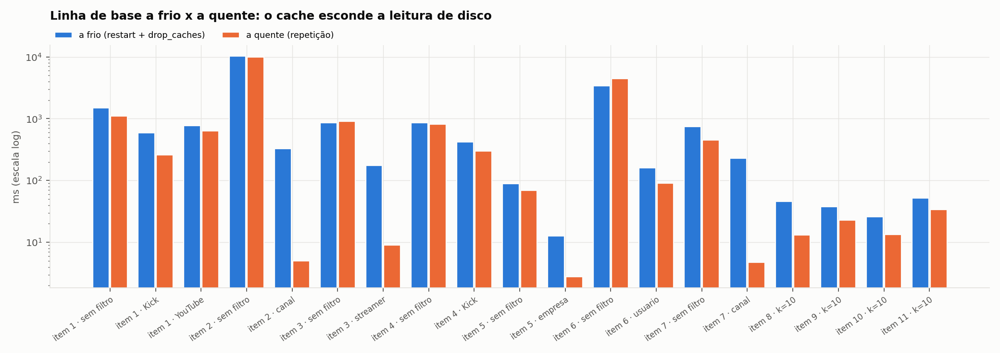
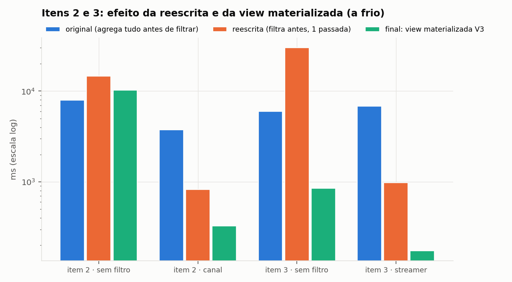
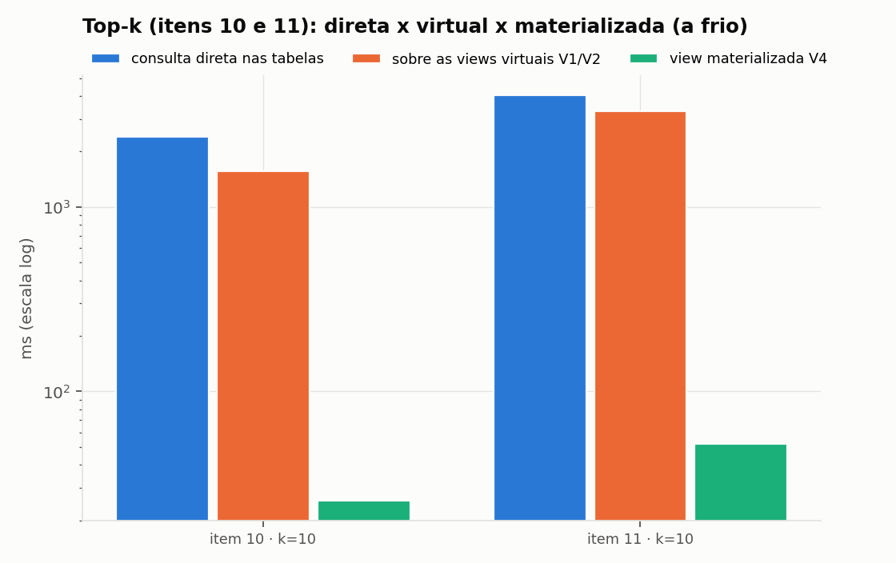
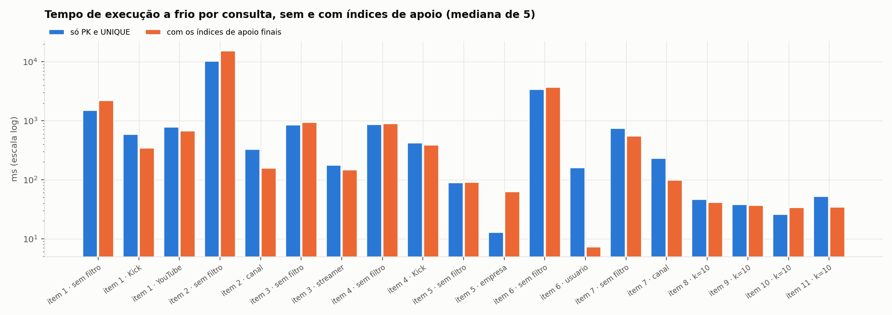

# Stream do Bedo · Benchmark

Este arquivo reúne as comparações de desempenho que embasaram as decisões de
consultas, views e índices (seções 6 a 8 do [decisions.md](decisions.md)). Os
gráficos estão em [`imagens/`](imagens/).

## Ambiente e protocolo

| Item | Valor |
|---|---|
| Banco | PostgreSQL 17.11 (Docker `postgres:17`, aarch64), num MacBook Air M1 |
| Configuração | Padrão do container: `shared_buffers` 128 MB, `work_mem` 4 MB, `effective_cache_size` 4 GB |
| Sessão de medida | `jit = off` e `max_parallel_workers_per_gather = 0`, para os tempos serem comparáveis |
| Dados | Seed na escala 1: cerca de 8,7 milhões de registros e 1,5 GB de schema |
| Medida | `EXPLAIN (ANALYZE, BUFFERS)` da chamada real da function |
| A frio | Antes de **cada** medida: reinício do Postgres (esvazia o `shared_buffers`) e `drop_caches` na VM do Docker (esvazia o cache do sistema). Vale só se houver `shared read` > 0 |
| A quente | Uma execução de aquecimento e depois as medidas, sem reiniciar |
| Repetições | 5 por cenário; o valor usado é a **mediana** |
| Volume | 810 medidas de consulta e 14 de escrita |

**Como ler os números:**
- **Páginas lidas** (`shared read + hit`) são a métrica mais estável. O tempo a
  frio de consultas de poucos milissegundos varia dezenas de ms entre repetições,
  por causa do primeiro acesso ao disco e ao catálogo.
- **Os tempos absolutos dependem da máquina.** O que vale é a comparação entre
  cenários.

## 1. Frio × quente: por que medir a frio

O cache esconde quase todo o custo das consultas seletivas:

| Consulta | A frio | A quente | Diferença |
|---|---:|---:|---:|
| Item 2, filtro por canal | 326 ms | 5 ms | 65× |
| Item 3, filtro por streamer | 175 ms | 9 ms | 19× |
| Item 7, filtro por canal | 228 ms | 5 ms | 48× |
| Item 1, plataforma pequena (Kick) | 587 ms | 257 ms | 2,3× |
| Item 1, sem filtro | 1.498 ms | 1.108 ms | 1,4× |

Medindo só a quente, quase toda consulta filtrada parece instantânea, e o índice
"não faz diferença". Foi esse o alerta do professor.

## 2. Reescrita das consultas antes dos índices

Tempo a frio, sem índices de apoio:

| Consulta | Original (agrega tudo, depois filtra) | Reescrita (filtra antes) | Final (sobre a V3) |
|---|---:|---:|---:|
| Item 2, sem filtro | 7.951 ms | 14.642 ms | 10.247 ms |
| Item 2, filtro por canal | 3.730 ms | 828 ms | **326 ms** (11×) |
| Item 3, sem filtro | 5.964 ms | 29.955 ms | **853 ms** (7×) |
| Item 3, filtro por streamer | 6.799 ms | 979 ms | **175 ms** (39×) |

- **Filtrar antes de agregar** resolve os casos com filtro.
- **Sem filtro, a reescrita direta piora:** agrupar 5 milhões de comentários
  estoura o `work_mem` e ordena em disco. Esses casos foram resolvidos pela view
  materializada V3.
- **O item 2 sem filtro continua caro.** Ele devolve e ordena 1,25 milhão de
  vídeos, e o custo é ordenar a saída. Com `LIMIT`, que é como a consulta é
  usada, vira uma ordenação parcial em memória.

## 3. Consulta direta × view virtual × view materializada

| Consulta (k = 10) | Direta nas tabelas | Sobre as views virtuais V1/V2 | Sobre a materializada V4 |
|---|---:|---:|---:|
| Item 10 | 2.409 ms | 1.569 ms | **26 ms** (93×) |
| Item 11 | 4.022 ms | 3.312 ms | **52 ms** (77×) |

- **A view virtual não acelera:** o planejador a expande dentro da consulta.
- **A materializada muda a ordem de grandeza,** em troca de dados com atraso.

Custo de atualizar as materializadas:

| View | `REFRESH` comum | `REFRESH CONCURRENTLY` |
|---|---:|---:|
| V3 `mv_interacoes_video` (1,25 milhão de linhas) | 7,9 s | 19,1 s |
| V4 `mv_faturamento_canal` (22,6 mil linhas) | 1,1 s | 1,3 s |

Por isso a atualização é periódica, e não por trigger.

## 4. Sem × com índices de apoio

Onde há um índice que atende o predicado, a mudança aparece no plano e nas
páginas lidas:

| Consulta | Sem índice de apoio | Com índice de apoio | Índice |
|---|---|---|---|
| Item 6, filtro por usuário | 160 ms, 4.040 páginas (`Seq Scan inscricao`) | **7 ms**, 54 páginas | `idx_inscricao_id_membro` |
| Item 1, plataforma pequena (Kick) | 587 ms, 25.526 páginas (`Seq Scan video`) | **341 ms**, 9.530 páginas (*Index Only Scan*) | `idx_video_id_canal_cobertura` |
| Item 3, filtro por streamer | 1.554 páginas; 9 ms a quente | **892 páginas**; 1,3 ms a quente | `idx_canal_id_streamer` |

Onde **não** há ganho, o plano e as páginas lidas são os mesmos com e sem
índice:
- **Itens sem filtro (1, 4, 6, 7) e item 1 com o YouTube** (28% dos canais):
  leem quase a tabela toda, e a varredura sequencial vence. É o caso "todos
  americanos" do professor.
- **Itens 8 a 11:** ordenam cerca de 30 mil linhas da V4 em milissegundos.

Algumas barras do gráfico 01 sobem com os índices, sem nenhuma mudança de plano
nem de páginas lidas:
- item 1 sem filtro, de 1,5 para 2,2 s;
- item 2 sem filtro, de 10 para 15 s;
- item 5 por empresa, de 13 para 62 ms.

Esses três casos não usam nenhum índice novo. A diferença é variação da leitura
a frio no disco da VM; a ordenação externa do item 2 é a mais sensível a isso.

## 5. Hash × B-tree nos predicados de igualdade

| Índice | Tipo | Páginas lidas | Tamanho (lote de teste) | `INSERT` em lote |
|---|---|---:|---:|---:|
| `Inscricao (id_membro)` | B-tree | 54 | 8,7 MB | 2.118 ms |
| `Inscricao (id_membro)` | hash | 54 | 10,6 MB | 2.310 ms |
| `Canal (id_streamer)` | B-tree | 892 | 1,1 MB | 342 ms |
| `Canal (id_streamer)` | hash | 892 | 1,3 MB | 344 ms |

O hash leu as mesmas páginas, ficou maior e não inseriu mais rápido. Ficou o
B-tree, que também entrega os dados em ordem e é o que a verificação de FK usa.

## 6. Ganho × custo de escrita

`INSERT` em lote numa cópia da tabela, com e sem o índice (mediana de 3, em
ordem aleatória):

| Índice | Linhas | Sem índice | Com índice | Overhead | Tamanho na tabela inteira |
|---|---:|---:|---:|---:|---:|
| `idx_inscricao_id_membro` | 300 mil | 1.328 ms | 2.118 ms | +59% | 10 MB |
| `idx_canal_id_streamer` | 35,9 mil | 292 ms | 342 ms | +17% | 0,7 MB |
| `idx_video_id_canal_cobertura` | 300 mil | 4.196 ms | 4.590 ms | +9% | 38 MB |

- **O mais caro, de `Inscricao`, é aceito:** inscrição é escrita rara e a busca
  por usuário é frequente.
- **`Canal (nro_plataforma)` foi descartado.** Era um índice de uma versão
  anterior. Na nova medição não teve ganho: `Canal` tem 951 páginas e é lida em
  milissegundos.

## 7. Item 12 (desafio)

Tempo a frio e a quente, com as páginas lidas entre parênteses:

| Forma | Sem filtro (k = 10) | Filtro Kick | Filtro YouTube |
|---|---|---|---|
| Versão anterior (sem posição global) | 57 / 91 ms (675) | 56 / 5 ms (672) | 31 / 13 ms (672) |
| Final, sem índices de apoio | 139 / 67 ms (1.438) | 99 / 47 ms (1.435) | 67 / 62 ms (1.435) |
| **Final, com os índices finais** | 64 / 67 ms (1.450) | 67 / 43 ms (1.447) | 62 / 42 ms (1.447) |
| Final + índice de cobertura em `Canal` | 66 / 49 ms (1.468) | 65 / 73 ms (1.465) | 67 / 44 ms (1.465) |
| Sobre uma V5 virtual | 73 / 46 ms (1.382) | 63 / 41 ms (1.378) | — |
| Sobre uma V5 materializada | 10 / 1,2 ms (302) | 8 / 1,3 ms (303) | — |

- **O custo vem da posição global.** Para dar a posição real mesmo com filtro, a
  consulta lê `Canal` inteira (cerca de 670 páginas) e conta os streamers
  distintos. Por isso a versão anterior era mais barata com filtro, mas
  respondia errado ("1º de 1").
- **Índice de cobertura em `Canal`: descartado.** O planejador não o usa, e ele
  seria o 6º índice.
- **V5 materializada: medida e não adotada.** O ganho é de cerca de 50 ms numa
  resposta de 28 linhas, e o item 12 deixaria de ser exato até a próxima
  atualização da view.

## Arquivos de origem

As medidas brutas (`resultados.csv`, `escrita.csv`), os planos em JSON, os
scripts de medição (`medir.sh`, `aferir.py`, `graficos.py`) e o inventário de
predicados estão na pasta `bench/` da tag `v1.1.0`.
